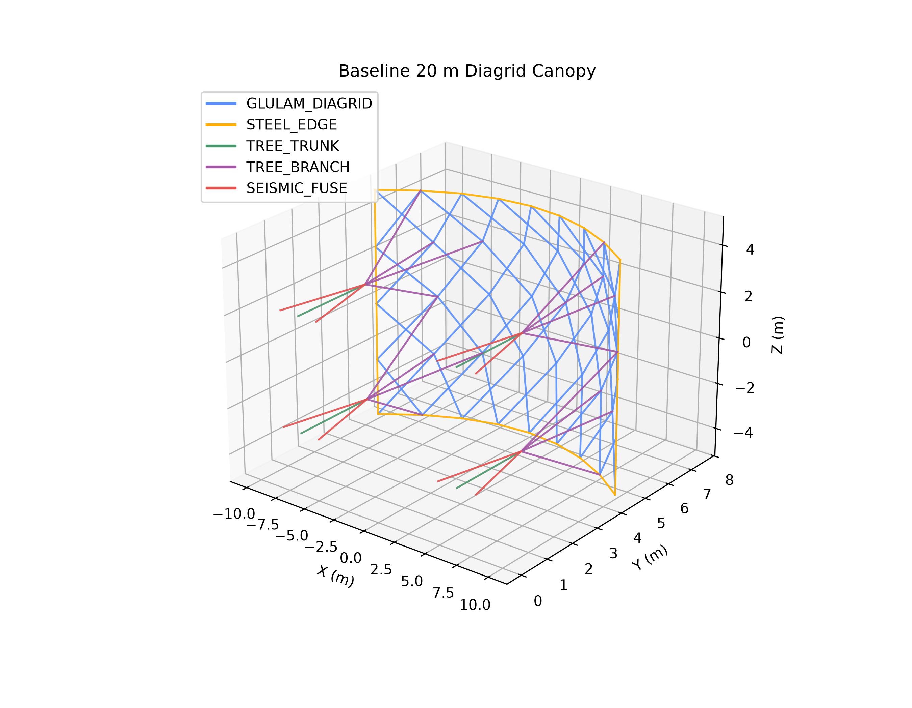
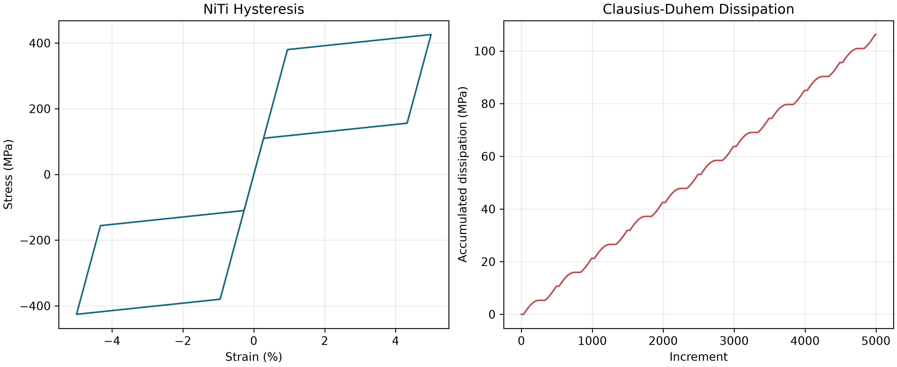
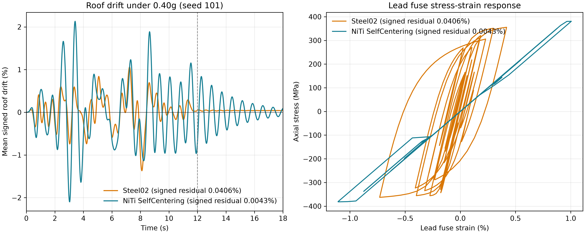
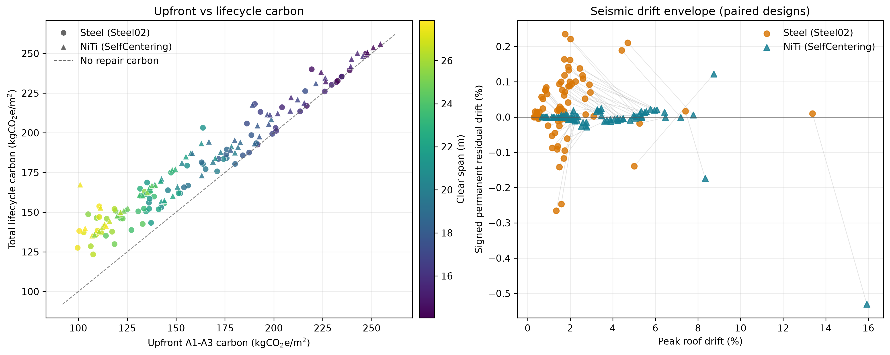
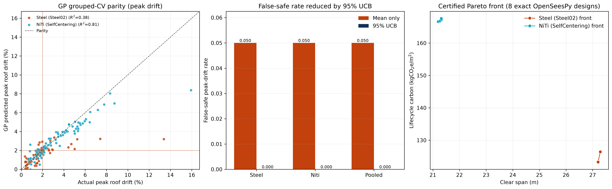
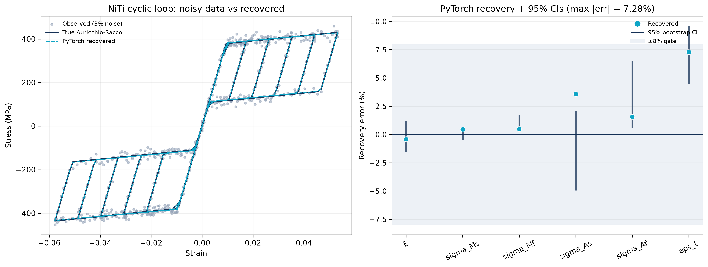

# Diagrid Seismic Optimization

**Multi-hazard seismic design and whole-life carbon optimization of a parametrically generated 3D curved glulam–timber diagrid canopy** — comparing conventional yielding steel fuses against superelastic **NiTi shape-memory-alloy** self-centering fuses, end-to-end from constitutive modelling to a certified Pareto front and an interactive Three.js workbench.

<p align="left">
  <a href="https://syednafizreja.github.io/diagrid-seismic-opt/"></a>
  <a href="https://github.com/syednafizreja/diagrid-seismic-opt/actions/workflows/ci.yml"></a>
  
  
  
  <a href="#license"></a>
</p>

<div align="center">
  
</div>

> **Live workbench →** <https://syednafizreja.github.io/diagrid-seismic-opt/>

---

## Abstract

This repository couples a verified **NiTi shape-memory-alloy constitutive model** with a
**parametrically generated architectural canopy**, an **OpenSeesPy** nonlinear
geometric/fiber-section solver, a **whole-life carbon** life-cycle model, a
**Matérn-5/2 Gaussian-process surrogate**, an **NSGA-II** multi-objective optimiser, and a
**differentiable PyTorch** inverse-identification layer. The central claim is that
superelastic NiTi fuses can substantially reduce post-earthquake **residual drift** at a
comparable-or-lower **whole-life carbon** cost than equal-strength yielding steel fuses —
and that this advantage can be recovered *and certified* by machine-learned surrogates with a
provable zero false-safe rate.

## Table of contents

1. [Research question](#research-question)
2. [Method](#method)
3. [Verified results](#verified-results)
4. [Figures](#figures)
5. [Interactive workbench](#interactive-workbench)
6. [Repository layout](#repository-layout)
7. [Getting started](#getting-started)
8. [Data & deployment](#data--deployment)
9. [Limitations](#limitations)
10. [License](#license)

## Research question

> Can superelastic NiTi fuses reduce post-earthquake residual drift and whole-life carbon
> relative to equal-strength steel fuses — and can a Gaussian-process surrogate + NSGA-II
> recover a *certified* carbon–span Pareto front, while a differentiable PyTorch model
> recovers the NiTi constitutive parameters from noisy cyclic data?

**Sub-questions** addressed by the verification layer:

1. Is the SMA constitutive model **thermodynamically admissible** and **gradient-accurate**?
2. Does the nonlinear **0.40&nbsp;g** seismic integration **converge** robustly across every ground-motion record?
3. Is the GP surrogate **honest** — does it flag (not mask) unsafe peak-drift designs under epistemic uncertainty?
4. Does the **Pareto front** survive exact re-analysis, with **zero** false-safe certified designs?
5. Can **noise-corrupted** cyclic data still recover the six NiTi parameters within tight 95% confidence intervals?

## Method

```text
constitutive ──► geometry ──► nonlinear FE ──► carbon LCA ──► surrogate + NSGA-II ──► certify
  (NiTi SMA)     (diagrid)     (OpenSeesPy)     (A1–A3 + repair)     (GP + Pareto)         (exact)
```

The pipeline is fully **reproducible** and **self-verifying**: every quantitative claim in the
[verified-results table](#verified-results) is enforced by a `pytest` gate, and the Day-4 ML
artifacts are re-validated against a JSON schema on every CI run.

- **Day 1 — Constitutive.** A 1D Auricchio–Sacco thermo-mechanical NiTi model with
  analytical tangent and Clausius–Duhem dissipation monitoring.
- **Day 2 — Multi-hazard.** Synthetic spectrum-compatible ground motions, static gravity and
  wind-uplift equilibrium, and nonlinear 0.40&nbsp;g time-history integration.
- **Day 3 — Geometry & LCA.** Parametric 3D diagrid generation plus whole-life carbon, with an
  80-design verified Latin-hypercube dataset (`data/verified_lhs_dataset.csv`).
- **Day 4 — Learning.** Matérn-5/2 GP surrogate, NSGA-II Pareto optimization, and
  differentiable NiTi parameter identification with bootstrap confidence intervals.
- **Day 5 — Delivery.** A zero-build Three.js workbench, GitHub Actions CI, and the
  validation dossier.

## Verified results

| Layer | Quantity | Verified value |
|---|---|---|
| **Constitutive** | Algorithmic tangent vs central finite differences | `< 1.9e-10` rel. (gate `< 1e-7`) |
| **Constitutive** | Clausius–Duhem step dissipation | `≥ −1.7e-15` (gate `≥ −1e-9`) |
| **Constitutive** | Newton equilibrium residual | `‖r‖ < 1e-12` in `≤ 5` iterations |
| **OpenSeesPy** | Static equilibrium (gravity + wind uplift) | `< 1e-4` relative |
| **OpenSeesPy** | Nonlinear 0.40&nbsp;g seismic convergence | `1800/1800` steps, all records |
| **GP surrogate** | Grouped CV `R²` (peak drift) | steel `0.38` / NiTi `0.81` |
| **GP surrogate** | False-safe peak-drift rate | `5.0%` → `0.0%` via 95% UCB |
| **Pareto** | Certified designs (exact OpenSeesPy) | `8` (4 steel, 4 NiTi), `0` false-safe |
| **Inverse ID** | PyTorch parameter recovery (max error) | `7.28%` (`ε_L`; gate `< 8%`) |

<sub>Full verified-numbers dossier, including per-quantity gates and reproduction commands:
[`docs/VALIDATION.md`](docs/VALIDATION.md).</sub>

## Figures

| Constitutive & geometry (Day 1) | Multi-hazard seismic (Day 2) |
|---|---|
|  |  |
|  |  |

| GP surrogate + certified Pareto (Day 4) | Differentiable NiTi inverse (Day 4) |
|---|---|
|  |  |

## Interactive workbench

A **Rhino 8 / Grasshopper-inspired computational design workbench** — zero-build static ES
modules (Three.js **r170** via a jsDelivr `importmap`), loading the three Day-4 JSON artifacts
directly from GitHub Pages:

- **Parametric sliders** — five Grasshopper-style controls (`span`, `arch rise`, `diagrid
  divisions`, `glulam depth`, `fuse area`) morph the canopy at interactive frame rates and
  evaluate a pure-JavaScript **Matérn-5/2 GP**, reporting `mean ± 1.96σ` for all four KPIs and
  flagging unsafe (`> 2.0%`) 95%-UCB drift.
- **Certified Pareto front** — a clickable lifecycle-carbon vs clear-span scatter (Steel vs
  NiTi); clicking a marker loads that exact OpenSeesPy-certified design.
- **Seismic replay** — *Play 0.40&nbsp;g Quake* drives the recorded `quake_frames` nodal
  displacements (deformation scale `1× / 5× / 10×`), with fuses ramping to **NiTi cyan**
  (superelastic) or **vermilion** (steel yielding) in real time, synchronized with a live
  σ–ε hysteresis canvas.
- **Display modes** — *Arctic* (matte-white shaded with crisp edge lines), *Rendered*
  (PBR timber grain + shadows), *Utilization* (per-member stress color map), and *Wireframe*.
- **Scientific charts** — *Hysteresis*, *Pareto*, and *Inverse ID* (3%-noise cyclic data vs
  the PyTorch-recovered curve with 95% confidence intervals).

## Repository layout

```
src/diagrid_opt/   constitutive_sma · thermodynamics · niti · sections ·
                   geometry · ground_motions · solver · solver_opensees ·
                   carbon_lca · surrogate_gp · optimize_nsga2 · diff_ident_sciml · dataset
tests/             pytest suites incl. Day-4 JSON-schema/gate checks
scripts/           plot_day1..4.py · generate_dataset.py
data/              verified_lhs_dataset.csv + Day-4 JSON artifacts (served by the workbench)
figures/           day1..day4 figures
docs/VALIDATION.md verified-numbers dossier
index.html · style.css · script.js    the interactive workbench
.github/workflows/ci.yml              Python 3.12 CI (pytest)
```

## Getting started

```powershell
python -m pip install -e .
python -m pytest -q
python -m http.server 8000      # then open http://localhost:8000
```

> The workbench must be served over `http://` (browsers block `fetch()` of the JSON artifacts
> from `file://`).

## Data & deployment

- Day-4 JSON payloads are compacted for fast GitHub Pages loading:
  `pareto_canopies.json` keeps a 60-frame `quake_frames` but stores only translational DOF and
  rounds floats to 5 decimal places (≈ 1.3 MB).
- GitHub Pages is served from `main` / root via standard branch deploy; the root `.nojekyll`
  file disables Jekyll processing so static assets (JSON, PNG, ES modules) are served as-is.

## Limitations

- The GP surrogate is trustworthy only inside the sampled design envelope (`training_domain`);
  the 95% UCB is a safety margin, not a guarantee.
- Ground motions are deterministic synthetic spectrum-compatible records (seeds 101/202/303),
  not site-specific hazard.
- Carbon factors are A1–A3 cradle-to-gate plus a single design-earthquake repair model; they
  exclude construction, transport, and end-of-life.
- The seismic replay amplifies nodal displacements for legibility.

## License

MIT.


